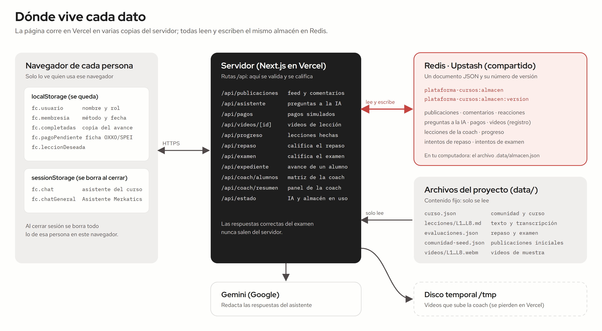
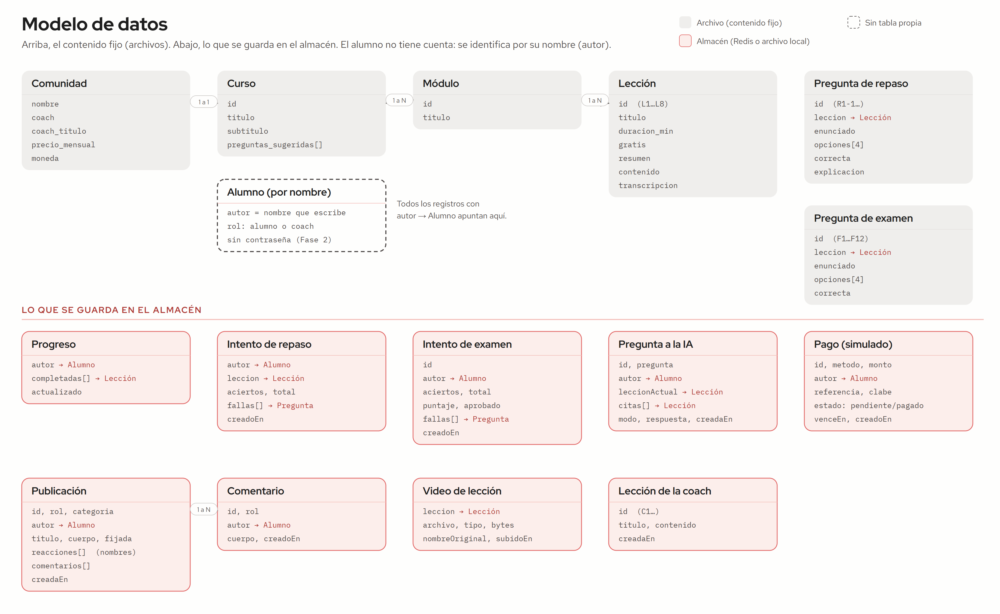
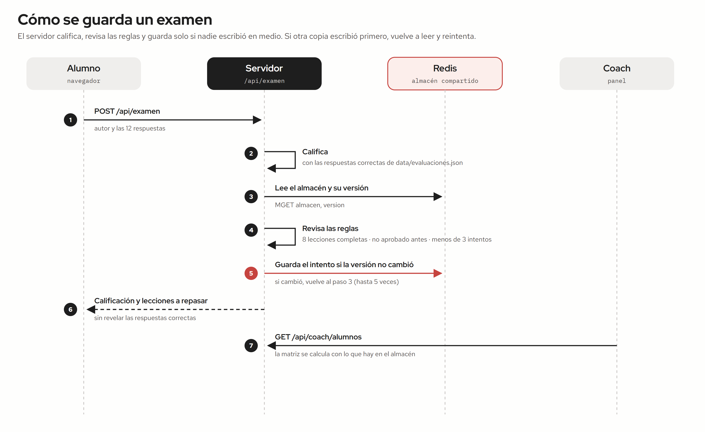

# Base de datos del MVP

La plataforma guarda lo que generan los usuarios en un **almacén**: un solo documento JSON con listas de publicaciones, comentarios, preguntas a la IA, pagos, avance y exámenes.

- **En línea (Vercel):** vive en Redis de Upstash, en la clave `plataforma-cursos:almacen`. La clave `plataforma-cursos:almacen:version` sube con cada cambio. Se activa al definir `KV_REST_API_URL` y `KV_REST_API_TOKEN` (o `UPSTASH_REDIS_REST_URL` y `UPSTASH_REDIS_REST_TOKEN`).
- **En local:** vive en `.data/almacen.json`. Si se borra la carpeta `.data`, se vuelve a crear con las publicaciones de ejemplo y los videos de muestra.
- **Para saber cuál se usa:** `/api/estado` responde `"almacen": "redis"` o `"almacen": "archivo"`.

El código está en [`lib/almacen.ts`](../lib/almacen.ts).

## Dónde vive cada dato

| Lugar | Qué guarda | Quién lo ve |
|---|---|---|
| Navegador (`localStorage`, `sessionStorage`) | Nombre y rol, membresía, copia de las lecciones completadas, ficha de pago pendiente, conversaciones con los asistentes | Solo quien usa ese navegador |
| Almacén (Redis o `.data/almacen.json`) | Publicaciones, comentarios, reacciones, preguntas a la IA, pagos, registro de videos, lecciones de la coach, progreso, repasos y exámenes | Todos, a través de la página |
| Archivos `data/` | Comunidad, curso, lecciones, preguntas del repaso y del examen (con respuestas), publicaciones iniciales, videos de muestra | Solo el servidor |
| Disco temporal `/tmp` | Videos que sube la coach en Vercel | Solo la copia del servidor que lo recibió |

## Modelo de datos

El alumno no tiene tabla propia: cada registro guarda el nombre con el que la persona entró (`autor`). Las cuentas reales llegan en la Fase 2.

| Colección | Campos principales |
|---|---|
| `publicaciones` | id, autor, rol, categoria, titulo, cuerpo, fijada, reacciones[], comentarios[], creadaEn |
| `preguntas` | id, autor, pregunta, leccionActual, citas[], modo, respuesta, creadaEn |
| `pagos` | id, autor, metodo, monto, referencia, clabe, estado, venceEn, creadoEn |
| `videos` | leccion, archivo, tipo, bytes, nombreOriginal, subidoEn |
| `leccionesCoach` | id, titulo, contenido, creadaEn |
| `progreso` | autor, completadas[], actualizado |
| `repasos` | autor, leccion, aciertos, total, fallas[], creadoEn |
| `examenes` | id, autor, curso, aciertos, total, puntaje, aprobado, fallas[], creadoEn (sin `curso`, es del curso principal) |
| `muestras` | lecciones cuyos videos de muestra ya se sembraron |
| `inscripciones` | autor, comunidades[] (a las que se unió), cursos[] (a los que se inscribió), desde |
| `semillas` | comunidades cuya publicación de bienvenida ya se sembró |

## Cómo se guarda un cambio

Cada escritura lee el almacén con su número de versión y guarda solo si ese número no cambió (un script de Lua en Redis lo comprueba y guarda en un solo paso). Si otra copia del servidor escribió primero, vuelve a leer y aplica el cambio otra vez, hasta 5 veces. Las respuestas correctas del examen solo viven en `data/evaluaciones.json`.

## Paso a la Fase 2 (Django y PostgreSQL)

| Hoy (MVP) | Fase 2 |
|---|---|
| `curso.json` y `lecciones/*.md` | Modelos `Comunidad`, `Curso`, `Modulo`, `Leccion`, con la comunidad como llave de cada cliente |
| `autor` = nombre | Usuario con autenticación e inscripción a cada comunidad |
| `publicaciones`, comentarios, reacciones | `Publicacion`, `Comentario`, `Reaccion` |
| `progreso` | `LeccionCompletada` |
| `evaluaciones.json`, `repasos`, `examenes` | `Examen`, `Pregunta`, `Opcion`, `Intento`, `Respuesta` |
| Pagos simulados | `Pago` con el proveedor elegido (modo de prueba) y webhooks |
| Videos en `/tmp` | Almacenamiento de objetos o servicio de video |
| Versión en Redis | Transacciones de PostgreSQL |
